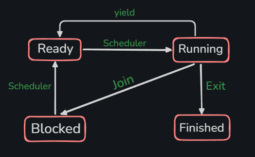

## xthread Design

#### 1. xthread_create()
```C
    int xthread_create
    (
        xthread_t *thread, void* (*func)(void *), void* arg, int stack_size
    );
```
- On successful returns '0' else returns '-1'. 
- if malloc fails to allocate stack, returns -1 with error msg.
- stack size is allocated by size of function, if stack size is passed 0, then default 64KB is allocated. 

#### 2. xthread_yield()
- A running thread calls another thread to run. Thread which calls `yield` goes back in queue. 
- Only a running thread can call this function. Blocked or Ready threads cannot.
```C
    void xthread_yield();
```

#### 3. xthread_exit()
```C
    void xthread_exit(void *retval);
```
- retval is something the exiting thread gives to the library, so the library can store it in the TCB.
- retval is used by other threads calling xthread_join().

#### 4. xthread_join()
```C
    int xthread_join(xthread_t thread_observed, void **retval);
```
- used by another thread to wait for the target thread.
- target thread could be running, blocked, or ready. 
- retval is an output, after return the target's result is written into `*retval`
- join on finished thread immediatly returns, joining the same thread twice is undefined behavior, it is caller's responsibility. 

#### 5. xthread_self()
```C
    xthread_t xthread_self(void); 
```
- returns currently running thread's data.

<br>



<br>

## Thread Control Block (TCB)

#### Sates : 
1. Running : when the thread is actually being executed. 
2. Ready : when the thread is waiting in queue to run
3. Blocked : waiting for its join target to finish
4. Finished : done running, retval is stored in the TCB until a joiner collects it.

- If Thread-A has called join() on Thread-B then Thread A is called 'joiner' and Thread-B is called 'target'. 
- it is joiner's responsibility to free the stack and TCB of target thread once target thread is finished. 
- Before erasing the target, joiner should first save the retval of target. 

- A  thread cannot free it's stack itself since the active threads needs stack for deallocation too.

## The big picture 
<br>


